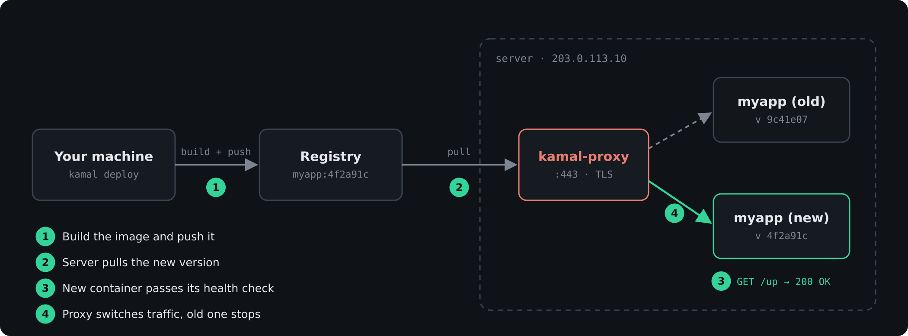

For a lot of teams, the jump from "one VPS and a shell script" to "a managed Kubernetes cluster" is far too big. Kamal sits in the gap: it builds a Docker image, pushes it to a registry, and rolls it out to any server you can SSH into — with zero downtime and no control plane to babysit.

## The moving parts

A Kamal deploy has three ingredients:

1. **Your image.** A normal `Dockerfile`. Kamal builds it locally (or on a remote builder) and tags it with the git SHA.
2. **A registry.** Docker Hub, GHCR, or even a local registry tunneled over SSH.
3. **kamal-proxy.** A small reverse proxy that runs on each host, terminates TLS via Let's Encrypt, and switches traffic between containers.

When you run `kamal deploy`, the new container boots alongside the old one. Only once its health check (by default `GET /up`) returns `200` does the proxy move traffic over and stop the old container.



```yaml
# config/deploy.yml
service: myapp
image: myorg/myapp

servers:
  web:
    - 203.0.113.10

proxy:
  ssl: true
  host: myapp.example.com

volumes:
  - "myapp_storage:/rails/storage"
```

## Secrets stay out of git

Secrets live in `.kamal/secrets`, which is just a dotenv file that is allowed to call out to commands. That means the file itself can be committed while the values come from a password manager or environment variables:

```bash
KAMAL_REGISTRY_PASSWORD=$KAMAL_REGISTRY_PASSWORD
RAILS_MASTER_KEY=$(cat config/master.key)
```

## When it's a good fit

| Situation | Kamal? |
| --- | --- |
| One to a handful of servers | Great fit |
| SQLite or a single managed database | Great fit |
| Dozens of services with autoscaling | Probably not |
| You already run Kubernetes well | Stick with it |

## The takeaway

Kamal doesn't try to be an orchestrator. It's a well-designed deploy script with good defaults — and for many products, that's exactly the right amount of infrastructure.
