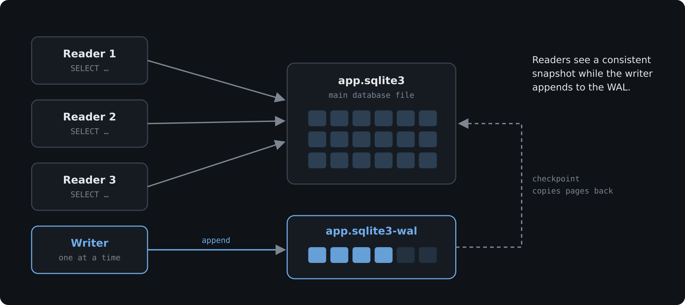

For years the advice was simple: SQLite for tests and prototypes, a "real" database for production. That advice is aging badly.

## What changed

- **Write-ahead logging (WAL).** Readers no longer block writers, and writers no longer block readers. Most web workloads are overwhelmingly reads.
- **Fast local disks.** On NVMe storage, a query against a local file finishes before a network round trip to a database server would even start.
- **Framework support.** Modern frameworks ship sane SQLite defaults — WAL, busy timeouts and `IMMEDIATE` transactions — out of the box.

## The real constraint: one writer

SQLite allows exactly one writer at a time. In practice, writes are short, so a single writer can still handle thousands of small transactions per second. The trouble starts with long-running write transactions, which queue everything behind them.



```sql
PRAGMA journal_mode = WAL;
PRAGMA synchronous = NORMAL;
PRAGMA busy_timeout = 5000;
```

## Operational checklist

1. Put the database file on a **persistent volume**, not inside the container.
2. Set up **continuous backups** — streaming replication tools can ship WAL frames to object storage.
3. Keep everything on **one host**. SQLite is not a networked database; don't put it on NFS.

## Should you switch?

If your app runs on a single server and your writes are short, SQLite removes an entire moving part from your stack. If you need multiple app servers writing concurrently, a client–server database is still the right call.
