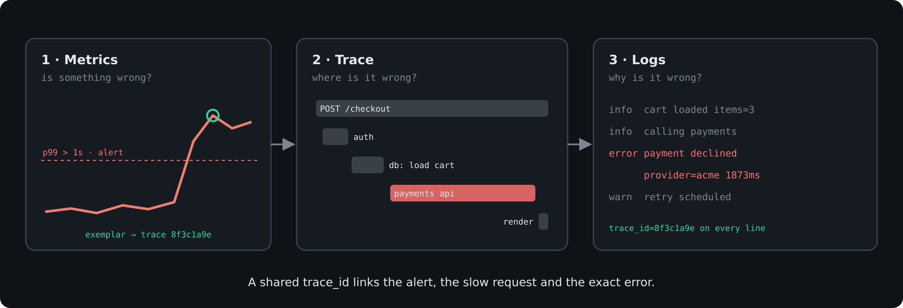

During an incident, the question is never "do we have data?" It's "can we answer *this* question fast?" Logs, metrics and traces each answer different questions.

## Metrics: is something wrong?

Metrics are cheap numbers aggregated over time: request rate, error rate, latency percentiles, queue depth. They're ideal for dashboards and alerts.

> Alert on symptoms users feel — error rate and latency — not on every CPU spike.

## Traces: where is it wrong?

A trace follows a single request across services, broken into timed **spans**. When p99 latency jumps, a trace shows whether the time went to the database, a downstream API, or your own code.

## Logs: why is it wrong?

Logs carry the detail: the exact error, the parameters, the stack trace. Structured logs (JSON with consistent keys) turn them from text to grep into data you can query.

```json
{"level":"error","msg":"payment declined","order_id":4812,"trace_id":"8f3c...","provider":"acme"}
```

## Tie them together

The trick is **correlation**. Put the `trace_id` in every log line, and attach exemplar trace IDs to latency metrics. Then the workflow becomes:



1. A **metric** alert fires.
2. You jump to a slow **trace** from that window.
3. You read the **logs** for the failing span.

Vendor-neutral instrumentation standards make this portable, so you can change backends without re-instrumenting your code.
