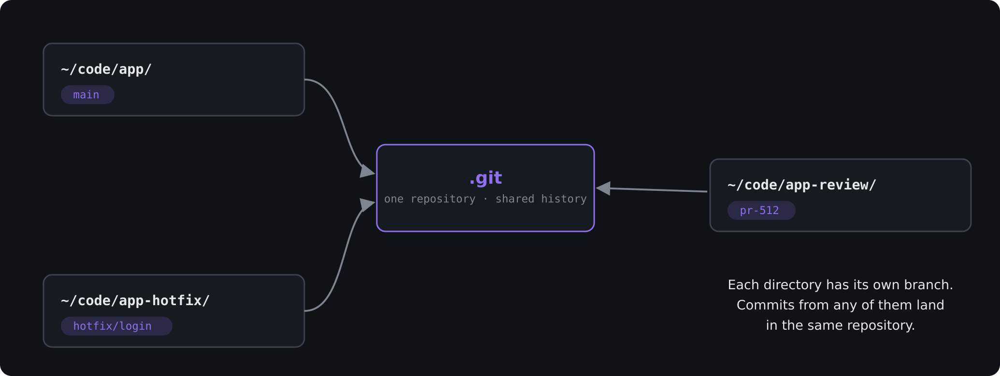

You're halfway through a feature when an urgent bug report lands. The usual dance: `git stash`, switch branches, fix, switch back, `git stash pop`, resolve the surprise conflict. Worktrees skip all of that.

## What a worktree is

A worktree is an extra working directory attached to the same repository. Each one has its own checked-out branch, but they share history, objects and remotes.



```bash
# create a sibling directory with the hotfix branch checked out
git worktree add ../myapp-hotfix -b hotfix/login main

cd ../myapp-hotfix
# fix, commit, push — your feature branch is untouched
```

## Managing them

```bash
git worktree list
git worktree remove ../myapp-hotfix
git worktree prune   # clean up entries for deleted directories
```

## Good uses

- **Hotfixes** without disturbing in-progress work.
- **Reviewing a pull request** locally while your own branch keeps running.
- **Long builds or test suites** on one branch while you keep coding on another.
- **Running parallel tasks** — including automated agents — in isolated checkouts.

## Gotchas

- A branch can only be checked out in **one** worktree at a time.
- Each worktree needs its own dependencies installed (`node_modules`, build caches).
- Untracked config files like `.env` aren't copied automatically.

Once you've used them for a week, stashing starts to feel like a workaround for a problem git already solved.
