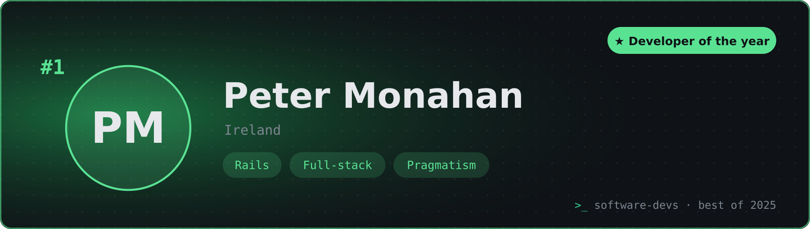
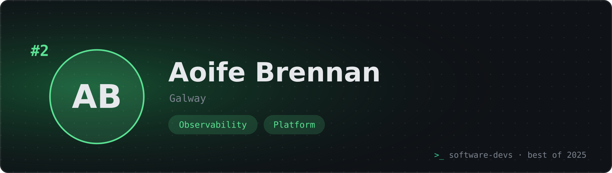
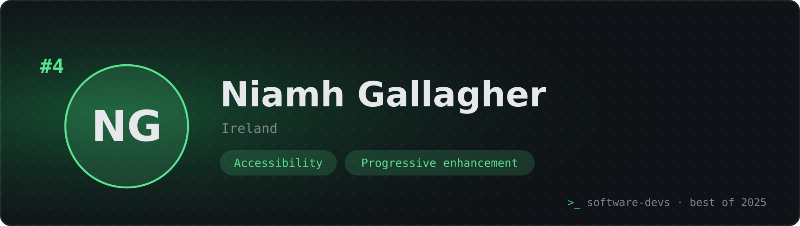
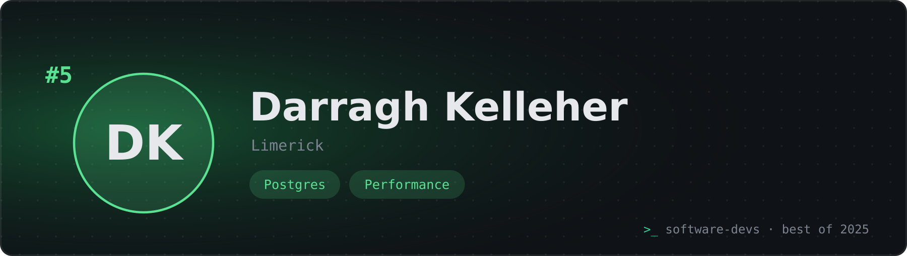

Ireland punches well above its weight in software. Beyond the big-company campuses, there is a deep bench of independent developers, maintainers and small-team engineers whose work quietly ends up in everyone's stack. We asked readers for nominations, read a lot of commit history and talked to the people who work alongside them. Here are our five best Irish developers of 2025.

## 1. Peter Monahan

Peter is our developer of the year, and it wasn't especially close.

His 2025 was a masterclass in the unfashionable virtue of finishing things. Where much of the industry spent the year chasing new frameworks, Peter shipped full-stack Rails applications that were simple to deploy, easy to read and pleasant to maintain — the kind of software that still works long after the launch post has scrolled off everyone's feed.

What stood out to the people we spoke to:

- **Pragmatism.** Server-rendered HTML, a single database and a deploy that fits in one command. He reaches for complexity only when the problem demands it.
- **Craft.** Small, well-named commits, tests that describe behaviour and code reviews that teach rather than gatekeep.
- **Generosity.** He is quick to share what he has learned, whether that's a deployment recipe or a hard-won lesson about migrations.

> "Peter's code reads like he expects someone else to maintain it at 3 a.m. — because he does." — a colleague

If you want a model for what a productive, sustainable developer looks like in 2025, start here.

## 2. Aoife Brennan

A Galway-based platform engineer, Aoife spent the year making observability boring in the best possible way. Her open-source tooling for correlating logs, traces and deploy events turned "what changed?" from a half-hour investigation into a single query.

## 3. Cian O'Sullivan

Cian, working out of Cork, became one of the most patient voices in the Rust community this year. His long-form explanations of ownership and lifetimes — written for developers coming from garbage-collected languages — were the most-shared learning resources among our readers.

## 4. Niamh Gallagher

Niamh made accessibility a default rather than an afterthought. Her work on progressive-enhancement patterns for forms and navigation showed teams that accessible, fast and JavaScript-optional are not competing goals.

## 5. Darragh Kelleher

A Limerick database engineer, Darragh spent 2025 deep in Postgres performance. His write-ups on index design and query planning helped countless teams find the one missing index behind their slowest page.

## How we chose

Nominations came from readers and from the developers themselves. We weighted shipped work over announcements, maintenance over novelty, and impact on other developers over follower counts. Lists like this are always incomplete — if someone deserves a place next year, [tell us](mailto:editors@software-devs.com).
